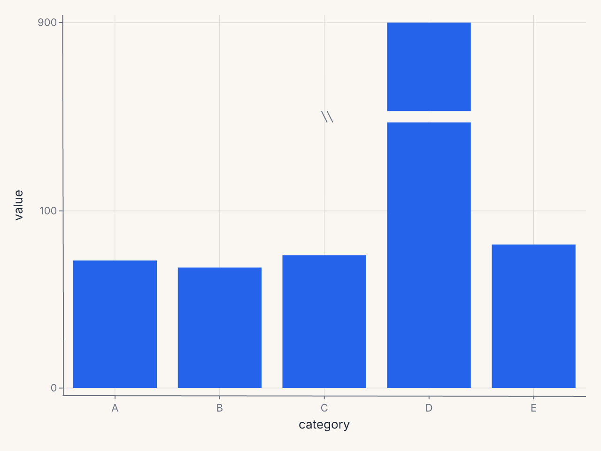
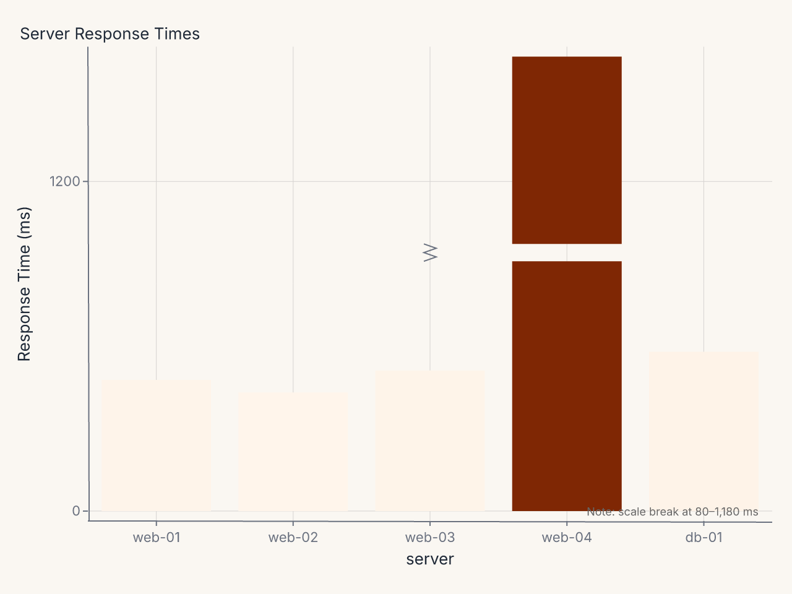
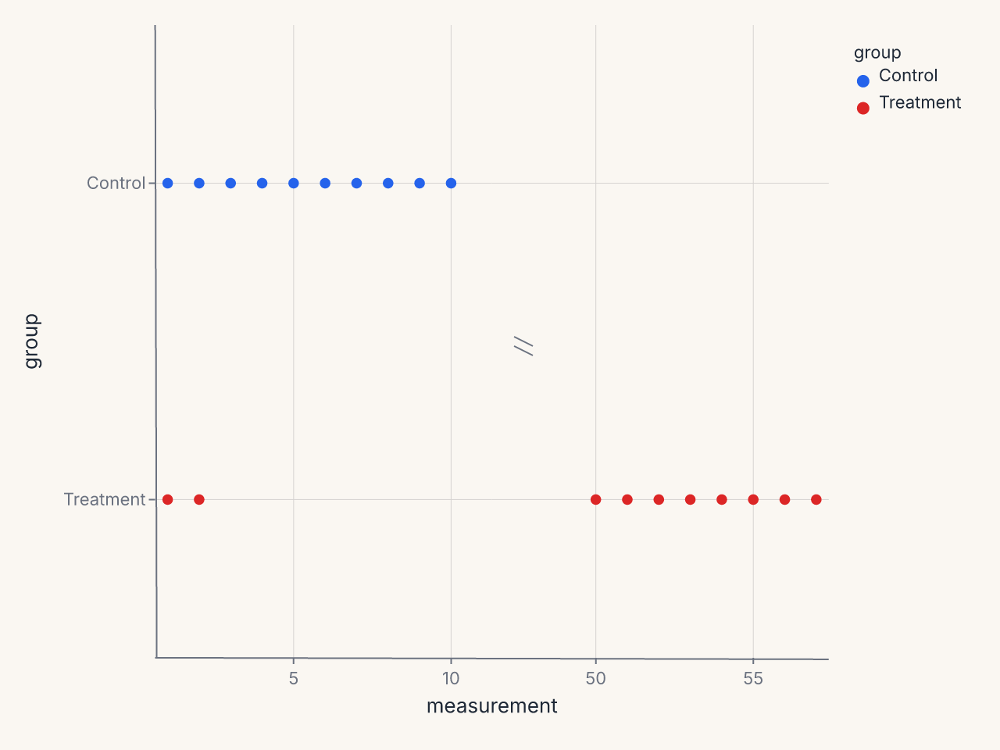
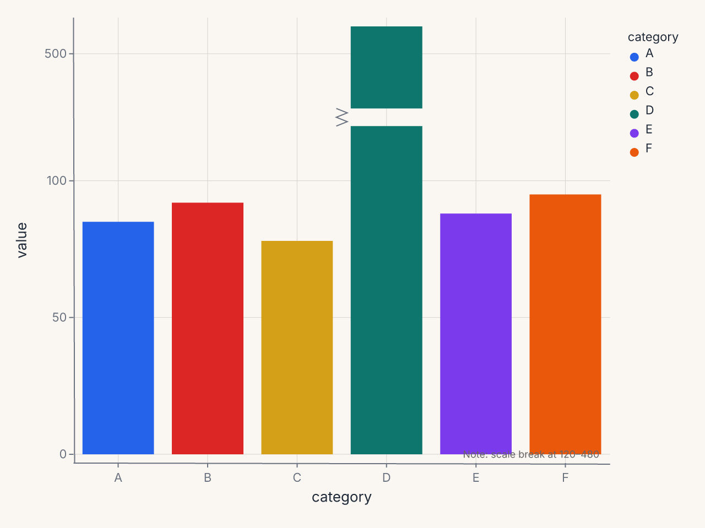

# Break Axes

`BreakAxis` splits a continuous scale into segments, omitting one or more ranges to
prevent outlier values from compressing the rest of the data. A visual break indicator
marks the gap.

---

## The problem it solves

When one data point is far from the rest — a revenue spike, a measurement error, a
special event — the scale adjusts to include it, compressing all other values into a
small band that makes differences hard to read.

```
value
  ↑
900│    ●         ← outlier at 900
   │
 80│  ● ● ● ●    ← data bunched here; differences invisible
 60│
```

`BreakAxis` removes the intermediate range [150, 850] and renders the two segments at
different vertical extents, with a visible gap indicator:

```
value
  ↑
900│    ●
 ~~~ (break)
 80│  ● ● ● ●
 60│
```

---

## Basic usage

Compose a `BreakAxis` onto a chart with `+`:

```python
import ferrum as fm
import polars as pl

df = pl.DataFrame({
    "category": ["A", "B", "C", "D", "E"],
    "value": [72, 68, 75, 900, 81],
})

chart = (
    fm.Chart(df)
    .mark_bar()
    .encode(x="category:N", y="value:Q")
    + fm.BreakAxis(axis="y", gap=(150, 850))
)
```



**Recipe: server response times with color scale and break annotation**

```python
import polars as pl
import ferrum as fm
import ferrum.annotation as ann

df = pl.DataFrame({
    "server": ["web-01", "web-02", "web-03", "web-04", "db-01"],
    "response_ms": [42, 38, 45, 1240, 51],
})

chart = (
    fm.Chart(df)
    .mark_bar()
    .encode(
        x=fm.X("server:N", sort=None),
        y="response_ms:Q",
        color=fm.Color(
            "response_ms:Q",
            scale=fm.SequentialScale(scheme="oranges"),
            legend=None,
        ),
    )
    .labs(title="Server Response Times", y="Response Time (ms)")
    + fm.BreakAxis(axis="y", gap=(80, 1180), break_style="zigzag", break_size=14)
    + ann.text(
        fm.norm(0.98), fm.norm(0.98),
        "Note: scale break at 80–1,180 ms",
        font_size=9, color="#666", anchor="end",
    )
)
```



---

## Constructor reference

```python
fm.BreakAxis(
    axis,               # str: "x" or "y" (required)
    gap,                # tuple | list[tuple]: break region(s) to remove (required)
    break_size=12,      # float: visual height of break indicator in pixels
    break_style="slash" # str: break indicator style
)
```

### Parameters

| Parameter | Type | Default | Description |
|---|---|---|---|
| `axis` | `str` | required | Which axis to break: `"x"` or `"y"` |
| `gap` | `tuple \| list` | required | One `(start, end)` pair, or a sequence of pairs. Each bound is **numeric** (`int`, `float`, or a numpy scalar such as `np.int64`) or **temporal** (ISO-8601 date/datetime `str`, `datetime.date`, `datetime.datetime`, `numpy.datetime64`, `pandas.Timestamp`) — see [Time series with a data gap](#time-series-with-a-data-gap) |
| `break_size` | `float` | `12` | Visual size of the break indicator in pixels |
| `break_style` | `str` | `"slash"` | Break indicator: `"slash"`, `"zigzag"`, `"wave"`, or `"gap"` |

The stored `gap` keeps the container type it was given (a tuple of pairs stays a tuple, so a tuple-spelled `BreakAxis` stays hashable), with each pair canonicalized to a 2-tuple. Temporal bounds are replaced by their epoch-millisecond floats at construction, so `BreakAxis(axis="x", gap=("2020-03-01", "2021-01-01")).gap` reads back as `(1583020800000.0, 1609459200000.0)`.

### Validation

Everything below raises `ValueError` at construction time, naming the offending value — never at render time, and never by silently rendering a blank or nonsense chart.

- `axis` must be `"x"` or `"y"`.
- `break_style` must be one of the four named styles.
- `gap` must be a tuple or list holding at least one `(start, end)` pair, and every pair must have exactly two bounds.
- Both bounds of one pair must be the same kind: a pair mixing a numeric bound with a temporal one is refused.
- Each coerced pair must be **finite** (no `NaN`, no `±inf`) and **ordered** (`start < end`; equal bounds are a zero-width gap and are refused too).
- A string bound that is not an ISO-8601 date or datetime is refused as an unparseable date, not as "not numeric".
- A not-a-time bound (`pandas.NaT`, `numpy.datetime64("NaT")`) is refused by name.
- A `numpy.datetime64` too large to represent as a microsecond-precision epoch offset is refused rather than silently wrapping to a meaningless instant.

Two things are deliberately *not* construction errors, because they depend on data the constructor cannot see: a gap that falls outside the axis's resolved domain, and a temporal gap on a non-temporal axis. Both render as if the break had not been declared and emit a `BreakAxisIneffective` warning.

---

## Break styles

| Style | Appearance | When to use |
|---|---|---|
| `"slash"` | Two diagonal parallel lines (///) | Default; clear, compact |
| `"zigzag"` | Zigzag waveform | Emphasizes the break |
| `"wave"` | Smooth sine curve | Subtle, clean |
| `"gap"` | Plain whitespace with no indicator | Minimal; for dense charts |

```python
fm.BreakAxis(axis="y", gap=(150, 850), break_style="zigzag")
```

---

## Multiple break regions

Pass a list of `(start, end)` tuples to break multiple regions:

```python
fm.BreakAxis(
    axis="y",
    gap=[(50, 200), (500, 900)],  # two separate gaps
)
```

The gaps in one spec are **merged into a union**, not applied one after another: they are sorted, overlapping or adjacent ranges are combined into a single removed range, and the result is clipped to the axis domain before any segment is laid out. `gap=[(50, 200), (150, 300)]` therefore removes `(50, 300)` once and draws one indicator, not two overlapping ones, and the order you write the pairs in does not matter.

Declaring two (or more) separate `fm.BreakAxis(...)` specs on the *same* axis merges their gaps into one break result instead of composing them sequentially — the render is identical to a single spec declaring the union of both gap lists. A conflicting `break_style`/`break_size` between the merged specs keeps the first declaration's value and warns once, naming the axis and the field that disagreed.

---

## Behavior with spanning marks

A mark whose value spans a break is clipped into the two visible segments. For example, a bar from 0 to 900 with a break at (150, 850) renders as two bar segments: one from 0 to 150 and one from 850 to 900. This is the semantically correct behavior — the full extent of the bar is preserved, just displayed in the two non-broken regions. A split rounded piece (`mark_bar`/`mark_rect(corner_radius=...)`) rounds only the corners it inherits from the source rect's own boundary; a corner sitting on the edge the gap cut is squared instead of rounded, so the two pieces read as one bar cut in half rather than two independently-rounded rects.

A mark placed by connected vertices — `mark_line`, `mark_rule`, `mark_segment`'s shaft, box/violin whiskers, and an area's `line=`/`borders=` outline — is cut at the gap edge into one stroke per visible segment, with the cross-axis coordinate at the crossing interpolated from the data, rather than drawing one connected stroke through the gap. A glyph mark (`mark_point`, `mark_tick`, `mark_text`, `mark_label`, `mark_image`) always moves and hides as a whole shape, on its own exact data position, never split or resized.

One shape does not split: a curved line (`mark_line(interpolate="basis"/"monotone"/"cardinal")`) still places each vertex independently and can draw a stroke spiking through the hidden gap — cutting a curve honestly needs subdividing it, which this does not yet do. A straight-segmented line (the default `interpolate`, and `"step"`/`"step-before"`/`"step-after"`) is unaffected and always splits cleanly.

---

## Horizontal break axes

`BreakAxis` works on either axis:

```python
df = pl.DataFrame({
    "group": ["Control"] * 10 + ["Treatment"] * 10,
    "measurement": [1, 2, 3, 4, 5, 6, 7, 8, 9, 10, 1, 2, 50, 51, 52, 53, 54, 55, 56, 57],
})

chart = (
    fm.Chart(df)
    .mark_point()
    .encode(x="measurement:Q", y="group:N", color="group:N")
    + fm.BreakAxis(axis="x", gap=(12, 48))
)
```



---

## Interaction with annotations

A point-anchored annotation (`ann.text`, `ann.callout`, `ann.image`) whose data-space coordinate falls inside a break's gap is suppressed with a warning naming the axis and how many annotation elements were dropped, so you can decide whether to move them or accept the suppression. A callout's background box is drawn size around its anchor, not a data extent, so it is never clipped even when it straddles the break indicator in pixels.

An extent-shaped annotation is handled by what its geometry means, mirroring the mark contract above:

- **`ann.rect`/`ann.span`** clip into one piece per visible segment, silently — the same clipping a bar's height goes through. A `span`'s optional label anchors on the midpoint of its largest surviving piece.
- **`ann.line`/`ann.arrow`** (including `annotate_hline`/`annotate_vline`'s rule and `annotate_arrow`) split into one piece per visible segment on the same rails as `mark_line`/`mark_segment`. An arrow's head rides the piece that reaches its tip; if the tip itself is in a gap, the head alone drops while the shaft's other visible pieces still render.
- **`ann.bracket`** is the one kind that still suppresses whole, with a warning naming the axis — its two endpoint tips assert a continuity a cut baseline cannot honestly carry.

An extent annotation is dropped only when nothing of it survives the gaps, or its kind admits no honest split at all (`ann.bracket`) — an annotation with one endpoint in a gap but a non-empty visible remainder now renders that remainder instead of vanishing.

---

## Faceted charts

`BreakAxis` applies to every facet panel, each broken against its own plot rect and its own scale's pixel range, using the same data-space gaps — a panel with a wider domain and a panel with a narrower one both get the gap cut at the same data values, placed correctly for each panel's own geometry. In the common case (shared-scale facets, the default), every panel reports the same diagnosis, so a faceted chart's warning text reads identically to a single-panel chart's. When panels genuinely disagree — an independent-scale facet (`Chart.share_scale(y="independent")`), or a bar mark's per-panel zero-baseline domain — the warning is qualified with the panel it was measured on and how many panels share it, rather than firing once per panel or silently speaking for panels it didn't measure.

---

## Interaction with SecondaryY

`BreakAxis` applied to the primary y axis has no effect on a secondary y axis (`SecondaryY`).
The two y axes have independent scales and the break applies only to the primary scale.

---

## Interaction with Polar and Geo coordinates

`BreakAxis` is not supported under `CoordPolar` or `CoordGeo` — a chart combining either coordinate system with any `BreakAxis` raises `ValueError` naming the coordinate and the axis, before any geometry is built. Both coordinate systems place their geometry independently of the resolved x/y scales (a polar wedge's angle/radius, a geoshape's projected lon/lat), so a break's linear pixel remap has no scale-relative position left to correct. Remove the break, or render the chart under Cartesian coordinates.

---

## Common patterns

### Suppress a single outlier

```python
+ fm.BreakAxis(axis="y", gap=(max_normal * 1.2, outlier_value * 0.9))
```

### Time series with a data gap

```python
+ fm.BreakAxis(
    axis="x",
    gap=("2020-03-01", "2021-01-01"),
    break_style="wave",
)
```

`gap` bounds accept ISO-8601 date/datetime strings, `datetime.date`, `datetime.datetime`, `numpy.datetime64`, and `pandas.Timestamp` directly — coerced to epoch-milliseconds UTC at construction, through the same conversion the encoding layer already applies to a temporal scale's domain. A naive (timezone-unaware) bound is treated as UTC; a timezone-aware one is converted to UTC first. Both bounds of one gap must be the same kind (numeric or temporal) — mixing them, or giving an unparseable string, raises `ValueError` at construction naming the value. A temporal gap that falls outside a *non*-temporal axis's domain is not a construction error: it renders as an out-of-domain gap and warns instead, the same as a numeric gap that misses the domain.

### Comparative bar chart with outlier suppression

```python
df = pl.DataFrame({
    "category": ["A", "B", "C", "D", "E", "F"],
    "value": [85, 92, 78, 510, 88, 95],
})

chart = (
    fm.Chart(df)
    .mark_bar()
    .encode(x="category:N", y="value:Q", color="category:N")
    + fm.BreakAxis(axis="y", gap=(120, 480), break_style="zigzag", break_size=16)
    + fm.annotation.text(fm.norm(0.98), fm.norm(0.98), "Note: scale break at 120–480",
                         font_size=9, color="#666", anchor="end")
)
```


